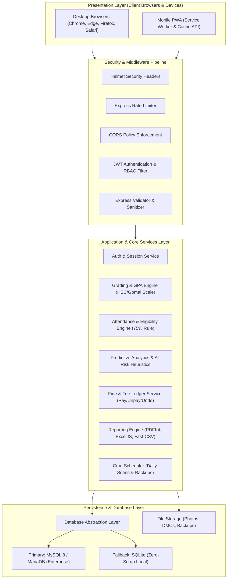
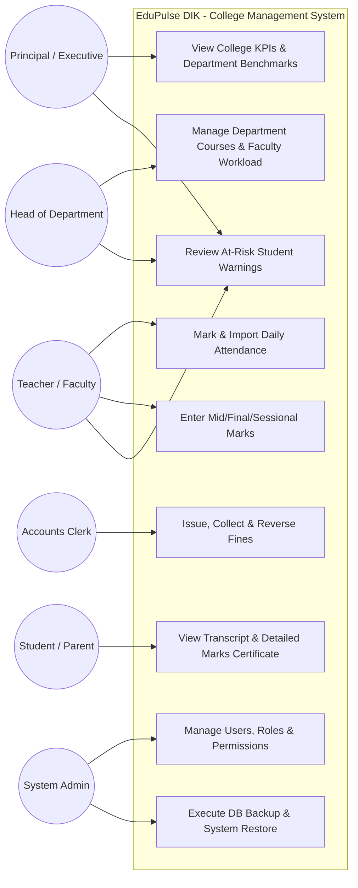
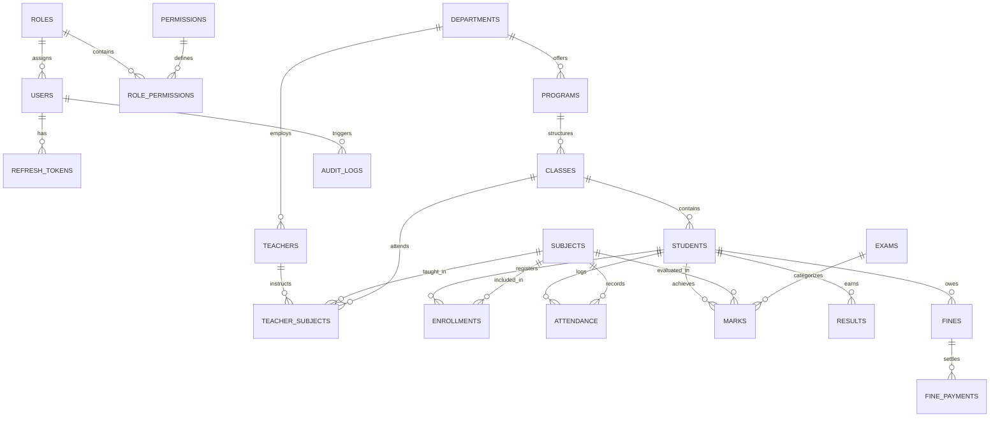
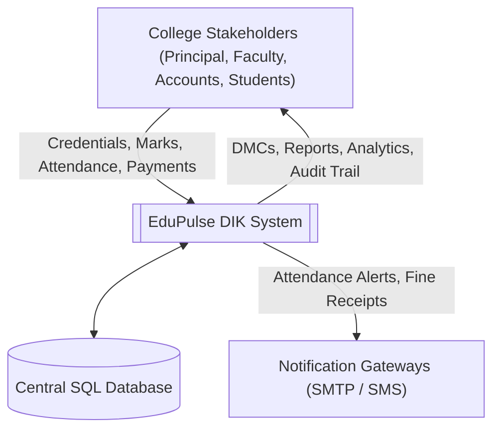
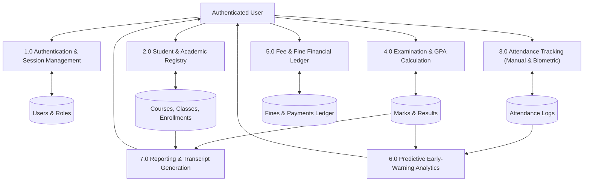
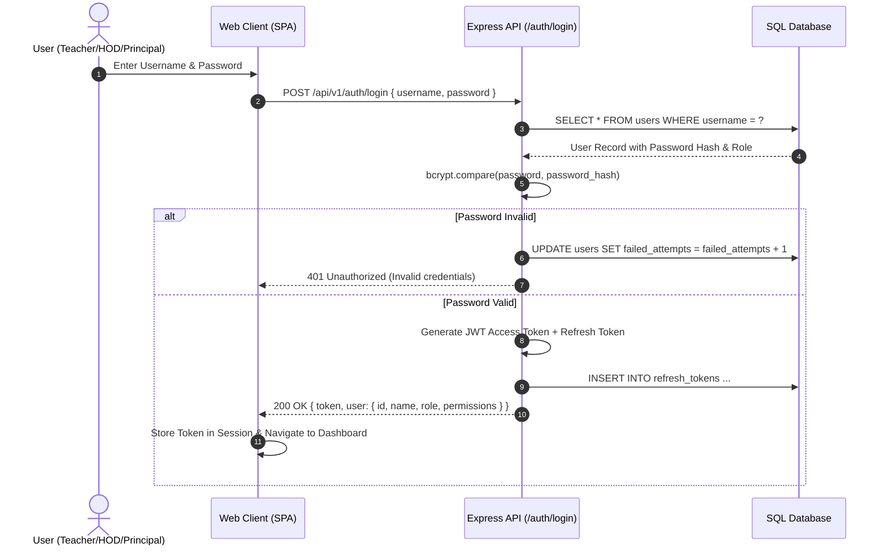
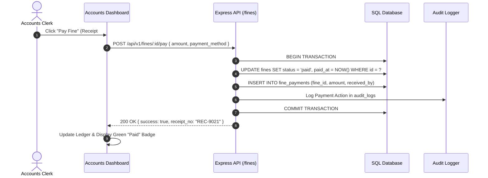
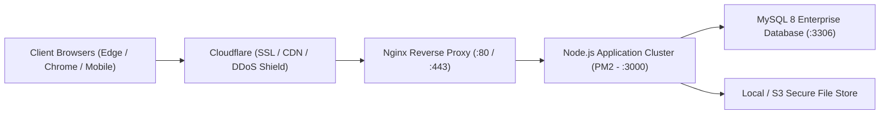

# Software Engineering Methodology & System Design
**Govt. Degree College No. 1, Dera Ismail Khan (D.I. Khan)**
*Final Year Project — EduPulse DIK (Student Performance Dashboard & College Management System)*

---

## 1. Development Methodology: Hybrid Engineering Model

In academic and enterprise software development, adopting a pure Agile approach often leads to incomplete documentation, while pure Waterfall lacks flexibility. For **EduPulse DIK**, we adopted an engineered **Hybrid Software Engineering Lifecycle Model**:

1. **Requirements & Architectural Specification (Waterfall Stage):** Complete upfront SRS (Software Requirements Specification), database entity-relationship modeling, and UX wireframing to establish the system scope and institutional policies.
2. **Implementation & Incremental Builds (Scrum Framework):** Divided into six 2-week sprints delivering testable increments (Sprint 1: Core Foundation & DB $\to$ Sprint 6: Deployment & Evaluation).
3. **Task & Flow Management (Kanban Board):** Continuous tracking through visual states: `Backlog` $\to$ `To Do` $\to$ `In Progress` $\to$ `Review/Test` $\to$ `Done`.
4. **Quality Assurance (V-Model Integration):** Every development artifact has a direct testing counterpart (Requirements $\leftrightarrow$ UAT, Architecture $\leftrightarrow$ System Tests, Module Design $\leftrightarrow$ Integration Tests, Code $\leftrightarrow$ Unit Tests).
5. **Delivery Mindset (CI/CD Ready):** Automated verification scripts, containerization, and single-command deployment routines.

---

## 2. Sprint Roadmap (6 Sprints)

| Sprint | Timeline | Objectives & Deliverables | Quality Gate |
|---|---|---|---|
| **Sprint 1** | Weeks 1-2 | Architecture setup, SQL schema, seed data, Auth/RBAC, DB abstraction layer | All tables indexed, JWT auth passes |
| **Sprint 2** | Weeks 3-4 | Core Entity CRUD (Students, Teachers, Departments, Classes, Subjects), global search | Full pagination, input validation active |
| **Sprint 3** | Weeks 5-6 | Marks entry, Gomal University GPA engine, Attendance register, DMC generation | 100% calculation accuracy against test cases |
| **Sprint 4** | Weeks 7-8 | Multi-Role Dashboards (Principal, HOD, Teacher, Student/Parent), Chart.js visual analytics | Cross-role data privacy, responsive layouts |
| **Sprint 5** | Weeks 9-10 | Fines Management (Pay, Unpay, Undo/Redo, Audit), Predictive At-Risk Heuristic Engine | Financial transaction audit trail verified |
| **Sprint 6** | Weeks 11-12 | Biometric import, Excel/CSV reporting, automated backup/restore, PWA, deployment | Production readiness, zero-downtime launch |

---

## 3. System Architecture Diagram

---

## 4. UML Use-Case Diagram

---

## 5. Entity-Relationship (ER) Diagram

---

## 6. Data Flow Diagram (DFD)

### Level 0 — Context Diagram

### Level 1 — Sub-System Decomposition

---

## 7. Sequence Diagrams

### 7.1 Authentication & RBAC Authorization Flow

### 7.2 Fine Payment & Instant Ledger Reversal Flow

---

## 8. Deployment Architecture Diagram

